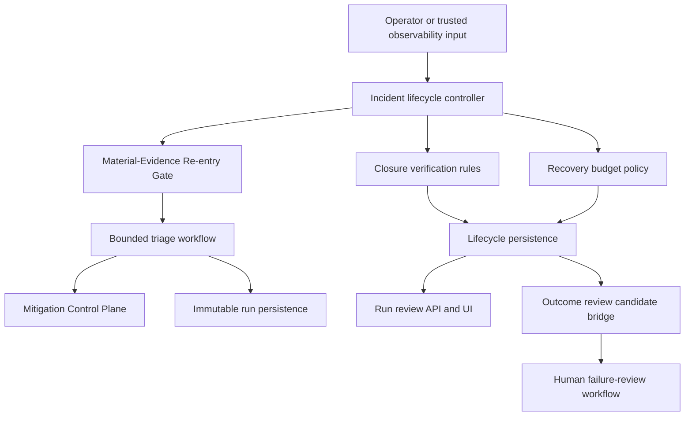
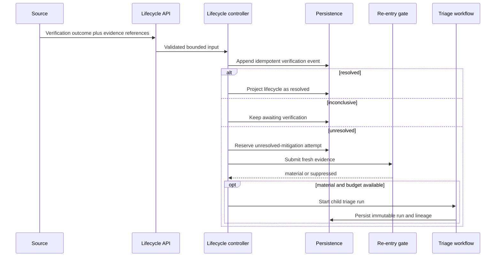
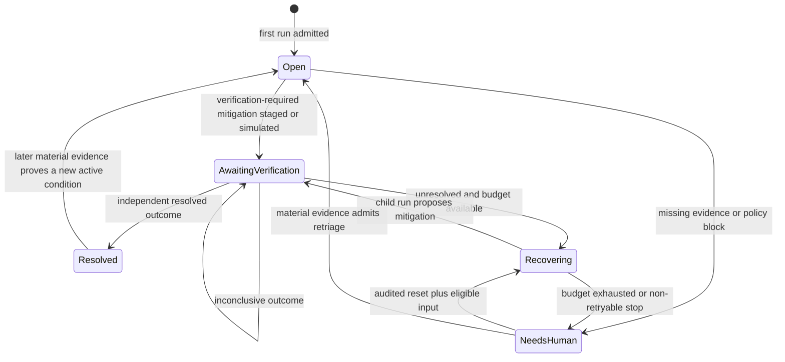
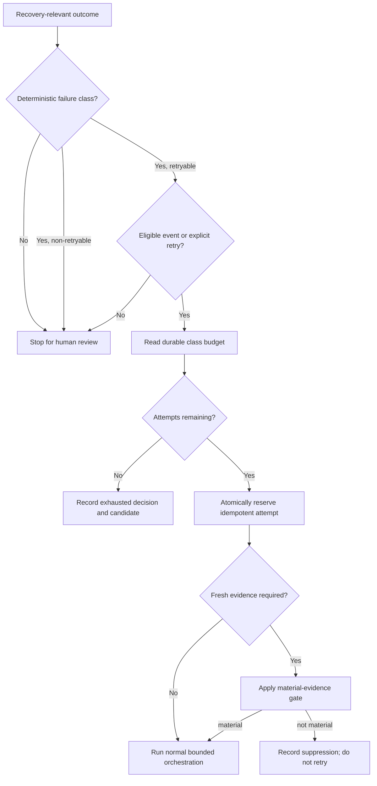
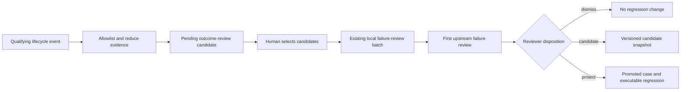
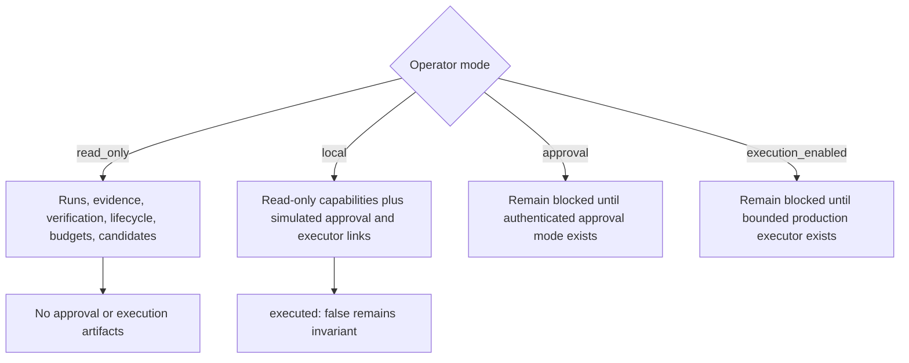
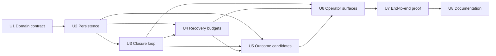

# Incident Closure and Recovery Loop

## Goal Capsule

| Field | Decision |
| --- | --- |
| Objective | Operators can tell whether an incident was actually resolved, why automated recovery stopped or continued, and which poor outcomes entered the regression-review pipeline. |
| Means | Add one durable lifecycle capability around immutable triage runs: closure verification, per-class recovery budgets, and human-reviewed outcome promotion. (KTD1, KTD4, KTD5) |
| Authority | Deterministic code owns lifecycle transitions, retry eligibility, audit records, and candidate creation. Humans or trusted observability evidence own closure. The LLM remains limited to its existing bounded triage judgment. |
| Stop conditions | Do not mark an incident resolved from an approval, recommendation, simulated execution, LLM claim, or elapsed time. Stop automatic recovery when its failure-class budget is exhausted. |
| Execution profile | Deep, phased TypeScript and Postgres change with API, CLI, browser, canary, and eval-review integration. |
| Delivery owner | The implementing agent completes code, tests, migrations, documentation, and local verification without adding production mutation authority. |

---

## Product Contract

### Summary

Extend the incident triage agent beyond recommendation and approval staging with a durable post-triage loop. Each incident can receive independent verification outcomes, automatic recovery attempts are bounded by failure class, and meaningful disagreements or unresolved outcomes become pending inputs to the existing failure-discovery process.

### Problem Frame

The current system can retriage material evidence, stage an approval, and record simulated executor output, but those events do not prove that an incident is resolved. Recoverable failures also lack a durable retry limit, and operator disagreement does not flow into the existing review and regression machinery without manual reconstruction.

### Key Decisions

- **Build the three capabilities as one incident lifecycle:** Closure verification, outcome promotion, and recovery budgets share incident and run lineage instead of becoming separate projects. (session-settled: user-approved — chosen over implementing the stage ledger, connectors, or service packs first: these three close the current operator feedback loop.) Governs R1-R20.
- **Require independent closure evidence:** A human operator or trusted observability input must record the closure outcome. (session-settled: user-approved — chosen over treating approval or simulated execution as resolution: action intent does not prove service recovery.) Governs R2-R7.
- **Budget recovery per failure class:** Each retryable failure class keeps its own durable counter and audited reset history. (session-settled: user-approved — chosen over one incident-wide retry count: unrelated failures must not consume each other's recovery allowance.) Governs R8-R13.
- **Keep eval promotion human-reviewed:** Runtime outcomes may create pending review candidates, but only the existing review workflow may promote cases or alter the failure taxonomy. (session-settled: user-approved — chosen over automatic regression activation: operational disagreement needs privacy checks and causal review.) Governs R14-R17.

### Requirements

**Closure verification**

- R1. The system must maintain a durable lifecycle view for each incident without mutating completed triage run envelopes.
- R2. A verification outcome must be one of `resolved`, `unresolved`, or `inconclusive` and must identify its source, actor or source reference, related run, evidence references, rationale, and timestamp.
- R3. Only an explicit operator decision or trusted observability evidence may record `resolved`; LLM output, approval, simulated execution, or scorecard success may not close an incident.
- R4. Approval or simulated execution for a verification-required mitigation must place the incident in an awaiting-verification condition.
- R5. `resolved` must close the current incident lifecycle while preserving all run, approval, verification, and re-entry lineage.
- R6. `unresolved` must keep the incident open and submit fresh evidence through the existing Material-Evidence Re-entry Gate before another triage run is admitted.
- R7. `inconclusive` must preserve the awaiting-verification condition and must not consume an automatic recovery attempt by itself.

**Durable recovery budget**

- R8. Automatic recovery attempts must be tracked durably by incident and failure class with an initial limit of three attempts per class.
- R9. The first supported retryable classes must cover provider unavailability, invalid model output, connector failure, and unresolved mitigation.
- R10. Missing evidence and policy or safety blocks must stop for human or new-evidence input rather than consume an automatic retry budget.
- R11. A recovery attempt and its resulting lifecycle event must be recorded atomically and idempotently before another automatic attempt can begin.
- R12. Exhausting one failure class must stop automatic retries for that class, remain visible to the operator, and leave manual review and material-evidence re-entry available.
- R13. A budget may reset only through an audited operator reset or a material evidence decision that names the affected failure class; equivalent evidence and generic retries may not reset it.

**Outcome-to-eval promotion**

- R14. The system must create a pending outcome-review candidate for unresolved mitigation, recovery exhaustion, a human correction to a triage finding, or a rejected recommendation with a supplied reason.
- R15. Candidate records must contain only allowlisted, reduced evidence plus durable references to the incident, run, verification or approval event, and outcome category.
- R16. Candidate creation must not activate a failure mode, change eval expectations, or write committed regression fixtures.
- R17. The failure-review CLI must import selected pending candidates into its existing review-batch format so a reviewer can identify the first upstream failure and decide whether to dismiss, categorize, or promote the case.

**Safety, modes, and reviewability**

- R18. `read_only` mode may record incident runs, verification evidence, lifecycle outcomes, recovery state, and review candidates, but it must not create approval or execution artifacts.
- R19. `local` mode may link existing simulated approvals and executor records to lifecycle events while preserving `executed: false` and making the simulation boundary visible.
- R20. Outside loopback-only local demos, human lifecycle mutation endpoints must use a write credential distinct from `OPERATOR_READ_TOKEN`; trusted observability inputs must retain signed-webhook authentication. All lifecycle writes must be idempotent under replay and visible in the run-review audit trail.

### Actors

- **Operator/SRE:** Reviews runs, approves or rejects simulated mitigation, records closure evidence, resets a recovery budget when justified, and curates failure candidates.
- **Trusted observability sender:** Supplies signed incident evidence that may prove recovery or continued impact.
- **Lifecycle controller:** Applies deterministic transition, retry, reset, and candidate rules around the existing triage workflow.
- **Triage workflow:** Produces immutable bounded decisions and remains unaware of human authority beyond the lifecycle inputs it receives.
- **Failure reviewer:** Imports candidates, identifies the first upstream failure, and controls taxonomy or regression promotion.

### Key Flows

- F1. **Verified closure**
  - **Trigger:** A verification-required incident receives operator or trusted observability evidence.
  - **Steps:** Validate the source, append the verification outcome, update the lifecycle view, and expose the event in run review.
  - **Outcome:** `resolved` closes the incident; `inconclusive` leaves it awaiting verification.
  - **Covers:** R1-R5, R7, R18-R20.
- F2. **Unresolved recovery**
  - **Trigger:** Verification says the mitigation did not restore service.
  - **Steps:** Record `unresolved`, classify `unresolved_mitigation`, reserve the next recovery attempt if budget remains, and pass fresh evidence through the re-entry gate.
  - **Outcome:** Material evidence may create a child run; equivalent evidence is suppressed; exhausted budget stops automatic retry.
  - **Covers:** R6, R8-R13, R20.
- F3. **Runtime recovery failure**
  - **Trigger:** The provider, response validator, or a connector fails on an otherwise eligible incident.
  - **Steps:** Classify the failure deterministically, atomically consume that class's attempt, and either retry through the normal orchestration path or stop at exhaustion.
  - **Outcome:** The operator sees the class, attempt count, limit, latest error summary, and allowed next actions.
  - **Covers:** R8-R13, R20.
- F4. **Outcome review promotion**
  - **Trigger:** A qualifying disagreement or terminal poor outcome is recorded.
  - **Steps:** Create a reduced pending candidate, let a reviewer select candidates into a local batch, then use the existing first-failure and promotion controls.
  - **Outcome:** Runtime observations become reviewable evidence without automatically changing committed evals.
  - **Covers:** R14-R17, R20.

### Acceptance Examples

- AE1. **Approval is not closure:** Given a bad-deploy run with a human-approved simulated rollback, when the review is refreshed, then the incident is awaiting verification and is not resolved.
- AE2. **Independent recovery evidence closes:** Given an awaiting-verification incident, when trusted evidence reports recovery with cited verification signals, then one idempotent `resolved` outcome closes the lifecycle and preserves prior lineage.
- AE3. **Inconclusive waits:** Given an operator note that does not establish service health, when it is recorded as `inconclusive`, then no retry budget is consumed and the incident remains awaiting verification.
- AE4. **Unresolved evidence re-enters safely:** Given a failed simulated mitigation and material new evidence, when `unresolved` is recorded, then the relevant budget advances and the evidence re-entry gate may create one child run.
- AE5. **Equivalent evidence cannot loop:** Given `unresolved` with evidence equivalent to the retained baseline, when recovery is requested, then re-entry is suppressed and no duplicate child run is created.
- AE6. **Failure classes are isolated:** Given two provider failures and one connector failure, when another connector retry is evaluated, then its count is two of three rather than four incident-wide attempts.
- AE7. **Exhaustion stops automation:** Given three failed provider attempts, when the same class is retried without an audited reset, then the system records an exhausted decision and does not call the provider.
- AE8. **Material evidence resets only the relevant class:** Given an exhausted connector budget and material evidence that changes connector context, when the gate admits re-entry, then the connector budget resets while the provider budget remains unchanged.
- AE9. **Poor outcome becomes a candidate:** Given an unresolved mitigation, when the lifecycle event commits, then one reduced pending review candidate is created and no failure taxonomy or committed eval file changes.
- AE10. **Human review remains the promotion gate:** Given a pending candidate, when a reviewer imports it, then the existing failure-review validation and first-upstream-failure requirements still apply before promotion.

### Success Criteria

- Every verification-required run has an operator-visible lifecycle state that distinguishes approval, simulated execution, awaiting verification, and verified resolution.
- Automatic retries cannot exceed their durable class-specific limit after restarts or duplicate delivery.
- A reviewer can move a qualifying runtime outcome into the existing failure-review workflow without manually rebuilding its trace.
- The read-only canary still proves zero approval and execution artifacts while exercising lifecycle persistence.

### Scope Boundaries

**Included**

- Closure outcomes, lifecycle audit events, recovery budgets, candidate records, APIs, CLI controls, run-review UI, Postgres persistence, and deterministic tests.
- Existing local simulation and read-only paths.

**Deferred to Follow-Up Work**

- A full typed stage ledger for every investigation phase.
- Production Grafana/Loki/deploy connector expansion beyond the existing boundaries.
- Versioned service investigation packs.
- Multi-instance leases, queues, or a general event-sourcing platform beyond transaction-safe Postgres writes.
- Multi-user RBAC or OIDC; this phase uses one configured operator write principal and keeps approval/execution modes blocked.

**Outside this plan**

- Production mutation, autonomous remediation, alert closure, or bypassing human approval.
- LLM-authored closure decisions, retry policy, mitigation catalog entries, or eval promotions.
- Automatic activation of failure modes from runtime data.

### Sources

- `src/workflow.ts` and `src/mitigation-control.ts` establish the bounded run and simulated verification behavior that this plan extends without redefining.
- `src/persistence/index.ts` and `src/persistence/migrations/003_material_evidence_reentry.sql` establish immutable run records, evidence snapshots, idempotent gate decisions, and transactional Postgres writes.
- `src/reentry.ts` establishes canonical evidence deltas and materiality as the only automatic retriage admission path.
- `evals/failure-discovery.ts` and `scripts/failure-review.ts` establish pending review, first-upstream-failure analysis, allowlisted promotion, and taxonomy controls.
- `docs/solutions/architecture-patterns/bounded-llm-incident-triage-workflow.md` requires deterministic workflow ownership and keeps safety outside the prompt.
- [triagebot-action verification handler](https://github.com/withastro/triagebot-action/blob/main/src/handlers/verify-fix.ts) provides the `confirmed` / `rejected` / `inconclusive` closure pattern.
- [triagebot-action retry handling](https://github.com/withastro/triagebot-action/blob/main/src/handlers/triage.ts) provides the bounded three-attempt recovery precedent.
- [triagebot-action re-triage handler](https://github.com/withastro/triagebot-action/blob/main/src/handlers/retriage.ts) reinforces re-entry only when a new input can change the result.

---

## Planning Contract

### Key Technical Decisions

- KTD1. **Append lifecycle records around immutable runs.** Add verification, recovery, and candidate records keyed to incident and run lineage instead of adding mutable terminal fields to `TriageRunRecord`. This preserves the current run store as an evidence record. (session-settled: user-approved — chosen over three independent subsystems: the capabilities need one auditable incident lifecycle.) Implements R1, R5, R20.
- KTD2. **Use deterministic closure inputs.** Accept bounded operator input or trusted normalized observability status; do not ask the LLM whether an incident is resolved. The existing verification plan remains guidance, not evidence. Implements R2-R7.
- KTD3. **Route unresolved evidence through the existing re-entry gate.** Closure handling may request recovery, but only `MaterialityDecision` can admit a child triage run. Implements R6, R13.
- KTD4. **Use one three-attempt limit with separate counters per retryable class.** Start with a uniform limit of three while keeping the policy catalog class-addressable; missing evidence and policy blocks are non-retryable stops. (session-settled: user-approved — chosen over one shared incident counter: each failure class needs independent exhaustion and reset.) Implements R8-R13.
- KTD5. **Bridge runtime outcomes into failure review as pending candidates.** Persist a reduced candidate and add an explicit import path to the existing local review batches; do not let runtime code write taxonomy or committed eval assets. (session-settled: user-approved — chosen over automatic eval activation: human causal review and privacy minimization remain mandatory.) Implements R14-R17.
- KTD6. **Make lifecycle writes idempotent and transaction-safe.** Use source event keys for verification, attempt keys for recovery, and a uniqueness key for candidates so duplicate webhooks, UI submissions, or process retries return prior results. Implements R11, R20.
- KTD7. **Derive the review view from durable records.** Extend the run-review response with the current lifecycle projection and recent events rather than introducing a second operator console. Implements R1-R7, R12, R19-R20.
- KTD8. **Separate read and write authority.** Add one configured operator write principal for human lifecycle mutations, load and redact its credential through the existing configuration boundary, and derive the audit actor from server configuration rather than request text. Preserve signed Grafana authentication for observability-derived outcomes; never upgrade `OPERATOR_READ_TOKEN` into mutation authority. Implements R2, R13, R17, R20.
- KTD9. **Reserve at most one recovery attempt per trigger.** A qualifying event or explicit operator retry may reserve one attempt, but the server must not run a recursive retry loop or add a background scheduler in this phase. Implements R8-R13.

### High-Level Technical Design

These sketches show component and protocol boundaries. They are directional; implementation should follow the repository's existing TypeScript, Valibot, and persistence patterns.

#### Component topology

#### Verification protocol

#### Incident lifecycle states

#### Recovery decision flow

#### Outcome-to-eval data flow

#### Authority by operator mode

### Data and Persistence Shape

- Add append-only verification events with a stable source-event key, bounded outcome, source metadata, evidence references, related run, and audit timestamps.
- Add per-incident, per-failure-class recovery state plus append-only attempt and reset events. The current counter is a projection maintained in the same transaction as its event.
- Add pending outcome-review candidates with category, source references, reduced snapshot, review state, retention metadata, and a uniqueness key tied to the causal lifecycle event.
- Extend `TriageRunReviewRecord` with the lifecycle projection and recent events. Do not copy lifecycle fields into historical run rows.
- Mirror Postgres behavior in the in-memory store so default and browser tests remain Docker-free.

### Sequencing

### Alternatives Considered

- **Mutate each completed run with final status:** Rejected because it weakens replayability and makes one historical run carry later human and observability decisions.
- **Build a general event-sourcing platform:** Rejected because the repo needs three bounded lifecycle record types, not a new infrastructure identity.
- **Retry directly from closure handling:** Rejected because it would bypass the material-evidence gate and recreate duplicate-loop risk.
- **Write runtime outcomes straight into `evals/`:** Rejected because it bypasses first-failure review, allowlisting, and the two-source threshold for active failure modes.
- **Run a multi-approach bake-off:** Not warranted because the existing immutable run store, append-only gate decisions, and manual promotion workflow establish one dominant implementation pattern; the alternatives above violate current contracts rather than presenting comparable architectures.

### System-Wide Impact

- **Data lifecycle:** New lifecycle and candidate records need retention and cleanup behavior aligned with current run evidence. Candidate snapshots must survive long enough for review without retaining unrestricted raw payloads.
- **Concurrency:** Duplicate webhook and UI submissions must converge on one verification, attempt, reset, or candidate record.
- **Security:** Operator-authenticated writes and signed observability ingestion remain separate trust paths. Neither path may smuggle closure or reset authority through LLM output.
- **Operational visibility:** Exhaustion and awaiting-verification states become first-class operator signals rather than inferred from workflow states.
- **Backward compatibility:** Existing stored runs without lifecycle records must render as open or not-yet-verified based on deterministic projection rules, not migration-time invention.

### Risks and Mitigations

| Risk | Consequence | Mitigation |
| --- | --- | --- |
| Verification status is inferred from weak text | False incident closure | Accept bounded write-authenticated input or trusted normalized status; require evidence references and preserve `inconclusive`. |
| Duplicate delivery spends attempts twice | Recovery stops too early | Use source keys, attempt keys, uniqueness constraints, and one transaction for reservation plus audit. |
| Retry logic bypasses re-entry | Infinite or low-value triage loops | Make the lifecycle controller call the existing gate and test equivalent-evidence suppression. |
| Candidate snapshots retain sensitive payloads | Privacy and credential exposure | Reuse allowlisting and credential rejection before persistence or export. |
| Runtime candidate creation changes eval behavior | Unreviewed regression noise | Keep candidates pending and require the current review and promotion commands. |
| Historical runs lack lifecycle rows | UI ambiguity after deployment | Define a conservative derived state and display that no independent verification has been recorded. |

---

## Implementation Units

### U1. Define the incident lifecycle domain contract

- **Goal:** Establish bounded lifecycle states, verification outcomes, retryable failure classes, reset reasons, candidate categories, and deterministic transition rules.
- **Requirements:** R1-R10, R12-R16, R18-R19; KTD1-KTD5.
- **Files:** `src/incident-lifecycle.ts`, `tests/incident-lifecycle.test.ts`, `CONCEPTS.md`.
- **Approach:** Keep lifecycle decisions in a pure domain module. Separate event facts from the current projection, reject invalid transitions, and classify retryability without using LLM output. Define compatibility behavior for incidents whose historical runs predate lifecycle records.
- **Test scenarios:** Approval and simulated execution project to awaiting verification; only authorized `resolved` evidence closes; `inconclusive` preserves state; unresolved is retry-eligible; missing evidence and policy blocks are non-retryable; a resolved incident can reopen only from later material evidence.
- **Verification:** Focused domain tests pass with no persistence, server, or provider dependency.
- **Dependencies:** None.

### U2. Persist lifecycle events, budgets, and review candidates

- **Goal:** Make lifecycle state durable, idempotent, queryable, and consistent across the in-memory and Postgres stores.
- **Requirements:** R1-R2, R5, R8-R17, R20; KTD1, KTD4-KTD6.
- **Files:** `src/persistence/index.ts`, `src/persistence/migrations/004_incident_lifecycle.sql`, `tests/persistence.test.ts`, `tests/postgres-persistence.test.ts`.
- **Approach:** Extend the persistence contract with transaction-shaped operations for verification recording, recovery reservation/reset, candidate creation, and lifecycle review. Add uniqueness constraints for causal event keys and preserve append-only audit rows. Extend cleanup counts and retention behavior without changing prior migration checksums.
- **Test scenarios:** Duplicate verification returns the prior event; concurrent attempt reservation cannot exceed three; each failure class counts independently; reset records actor and reason; candidate creation is idempotent; cleanup removes expired lifecycle data in dependency-safe order; existing run-only rows remain readable.
- **Verification:** In-memory persistence tests pass by default, and the opt-in Postgres suite proves migration, transaction, uniqueness, restart durability, and cleanup behavior.
- **Dependencies:** U1.

### U3. Add the closure verification loop to server orchestration

- **Goal:** Accept independent verification, derive the current incident lifecycle, and route unresolved evidence through the existing re-entry gate.
- **Requirements:** R2-R7, R11, R18-R20; KTD2, KTD3, KTD6.
- **Files:** `src/config.ts`, `src/server.ts`, `src/reentry.ts`, `src/approval-store.ts`, `src/incident-lifecycle.ts`, `.env.example`, `tests/config.test.ts`, `tests/server.test.ts`, `tests/reentry.test.ts`.
- **Approach:** Add lifecycle read routes plus verification write routes anchored to incident and related run IDs. Human mutations use a new operator write credential outside loopback-only local demos; trusted observability continues through signed webhook authentication. Normalize both sources into the same bounded domain input. Link approval decisions by stable approval ID, and make the lifecycle append safely retryable if the local approval store succeeds before lifecycle persistence. On `unresolved`, record the outcome before asking the recovery policy and re-entry gate whether another run is admissible.
- **Test scenarios:** Valid operator and signed observability inputs record each outcome; forged or malformed inputs fail without writes; duplicate submissions are idempotent; resolved does not run triage; inconclusive spends no budget; unresolved plus equivalent evidence is suppressed; unresolved plus material evidence creates one child run; read-only mode creates no approval artifacts.
- **Verification:** HTTP integration tests prove response contracts, auth, replay behavior, and lineage across real server handlers with the in-memory store.
- **Dependencies:** U1, U2.

### U4. Enforce durable recovery budgets at every automatic retry boundary

- **Goal:** Prevent unbounded automatic retries while preserving safe recovery for transient failures.
- **Requirements:** R8-R13, R20; KTD3, KTD4, KTD6.
- **Files:** `src/recovery-budget.ts`, `src/server.ts`, `src/workflow.ts`, `src/loki.ts`, `src/context-sources/index.ts`, `tests/recovery-budget.test.ts`, `tests/server.test.ts`, `tests/workflow.test.ts`.
- **Approach:** Map existing provider, validation, connector, and unresolved-mitigation outcomes to the bounded failure taxonomy. Each qualifying external event or explicit retry request may reserve one attempt before orchestration; do not add recursive retries or a scheduler. Record the result and return an operator-visible exhaustion decision before calling the blocked dependency. Keep manual and material-evidence resets explicit and class-specific.
- **Test scenarios:** Each retryable class stops on its fourth request after three committed attempts; unrelated classes remain available; process restart preserves exhaustion; duplicate attempt keys do not increment; policy block and missing evidence stop without consuming; material evidence resets only its named class; manual reset requires authenticated actor and reason.
- **Verification:** Focused policy tests and server/workflow integration tests prove no external boundary is called after exhaustion.
- **Dependencies:** U1-U3.

### U5. Connect qualifying outcomes to the failure-discovery workflow

- **Goal:** Turn meaningful lifecycle disagreements into reviewable, privacy-minimized candidates without bypassing human promotion.
- **Requirements:** R14-R17, R20; KTD5, KTD6.
- **Files:** `src/outcome-promotion.ts`, `src/approval-store.ts`, `src/server.ts`, `evals/failure-discovery.ts`, `scripts/failure-review.ts`, `tests/approval-demo.test.ts`, `tests/failure-discovery.test.ts`, `tests/server.test.ts`.
- **Approach:** Build reduced candidate snapshots from allowlisted run, evidence, lifecycle, and approval references. Add bounded operator feedback for a corrected finding and extend approval rejection with optional actor and rationale fields; both use the lifecycle write authority from KTD8. Create candidates in the same transaction as their causal Postgres event, and use stable causal keys when the local approval file is the source. Extend the failure-review CLI with list/show/import operations that create ordinary pending review records and preserve the current annotate, validate, categorize, and promote gates.
- **Test scenarios:** Unresolved mitigation and budget exhaustion create one pending candidate; authenticated corrected-finding feedback and a reasoned rejection create candidates; generic rejection without rationale does not invent one; secrets and non-allowlisted fields are rejected or omitted; repeated causal writes and imports do not duplicate candidates or reviews; import alone cannot update taxonomy or committed cases.
- **Verification:** Failure-discovery tests prove snapshot reduction, import compatibility, first-failure validation, and unchanged promotion thresholds.
- **Dependencies:** U2-U4.

### U6. Make lifecycle state actionable in the operator surfaces

- **Goal:** Let an operator understand and act on verification, recovery, and candidate state from the existing run review experience and a scriptable CLI.
- **Requirements:** R2-R7, R12-R13, R17-R20; KTD7.
- **Files:** `src/run-review-console.ts`, `src/approval-console.ts`, `src/config.ts`, `src/server.ts`, `src/lifecycle-cli.ts`, `.env.example`, `package.json`, `tests/config.test.ts`, `tests/server.test.ts`, `tests/e2e/run-review-approval.pw.ts`, `tests/cli.test.ts`.
- **Approach:** Add a compact lifecycle panel to `/runs` showing current state, source, recent verification events, per-class attempt counts, exhaustion, and pending review candidates. Add explicit controls for `resolved`, `unresolved`, `inconclusive`, corrected-finding feedback, reasoned rejection, and audited class reset when the mode permits. Keep write credentials out of rendered HTML, logs, and persisted audit metadata. Provide equivalent JSON-first CLI commands for status, verify, feedback, reset, and candidate inspection.
- **Test scenarios:** Empty historical state is clear; approved simulation displays awaiting verification; each closure control refreshes to the durable result; reasoned rejection and corrected-finding feedback create visible pending candidates; errors remain near the action; exhausted classes disable automatic retry but not review; read-only mode hides approval controls while retaining allowed lifecycle evidence; credentials never appear in responses; CLI JSON matches API state.
- **Verification:** Playwright covers the complete operator path through real DOM and HTTP behavior; CLI and server tests cover scriptable parity.
- **Dependencies:** U3-U5.

### U7. Prove the closed loop across canary, persistence, and eval boundaries

- **Goal:** Demonstrate that the three capabilities work together without weakening the current safety contract.
- **Requirements:** R1-R20.
- **Files:** `scripts/run-recorded-triage.ts`, `tests/observability-integration.test.ts`, `tests/postgres-persistence.test.ts`, `tests/e2e/run-review-approval.pw.ts`, `tests/triage-outcomes.test.ts`, `tests/webhook-outcomes.test.ts`, `evals/incident-outcomes.eval.ts`.
- **Approach:** Extend the recorded scenario matrix with a lifecycle sequence: initial run, simulated approval where applicable, unresolved verification, material and equivalent evidence branches, recovery exhaustion, resolved verification, and candidate import. Keep model-quality evals separate from deterministic lifecycle assertions.
- **Test scenarios:** The canary records lifecycle state but no approval or execution artifacts; a local bad-deploy path moves from approval to awaiting verification to unresolved re-entry to resolved; equivalent evidence cannot create a loop; provider exhaustion survives Postgres restart; qualifying outcomes reach a pending review batch; existing deterministic eval gate names and live-provider opt-in behavior remain unchanged.
- **Verification:** The default suite, browser suite, Postgres suite, read-only canary, deterministic evals, typecheck, and build all pass in their documented environments.
- **Dependencies:** U2-U6.

### U8. Document the lifecycle contract and operating procedure

- **Goal:** Make closure authority, recovery limits, candidate review, and demo steps understandable without reading implementation code.
- **Requirements:** R1-R20.
- **Files:** `README.md`, `AGENTS.md`, `CONCEPTS.md`, `docs/ai-operator-architecture.md`, `docs/runbooks/phase-1-read-only-triage.md`.
- **Approach:** Update the architecture and operator walkthrough to distinguish triage completion, approval, simulated execution, awaiting verification, and resolution. Document recovery classes and reset authority, candidate import and review, read-only behavior, retention, and troubleshooting. Add new source files and safety constraints to `AGENTS.md` only after their interfaces exist.
- **Test expectation:** None; this unit documents behavior proven by U1-U7 and updates repository guidance.
- **Verification:** Commands, routes, state names, and screenshots or diagrams match the shipped behavior and use no real credentials or production claims.
- **Dependencies:** U1-U7.

---

## Verification Contract

| Gate | Command | Proves |
| --- | --- | --- |
| Deterministic unit and integration suite | `npm test` | Lifecycle transitions, idempotency, HTTP behavior, retry policy, candidate import, and existing safety contracts. |
| Browser operator flow | `npm run test:e2e` | Visible closure controls, recovery state, candidate state, success and error handling, and mode-specific UI. |
| Postgres integration | `npm run test:postgres` | Migration, atomic attempt reservation, uniqueness, restart durability, and cleanup. |
| Read-only production-shape canary | `npm run triage:read-only-canary -- --json` | Signed ingestion, persistence, lifecycle recording, re-entry, and absence of approval or executor artifacts. |
| Deterministic eval suite | `npm run evals` | Existing bounded-decision gates remain stable and promoted failure regressions remain executable. |
| Static contracts | `npm run typecheck` | Store, API, lifecycle, and CLI contracts agree. |
| Build | `npm run build` | Production TypeScript and copied assets compile with the new modules and migration. |

The default suite must remain Docker-free and network-free. Postgres remains opt-in through the documented Docker-backed environment. Live provider checks remain opt-in and may not be used to enforce deterministic lifecycle or safety policy.

---

## Definition of Done

- R1-R20 are implemented with direct coverage from the named tests and no launch-blocking question remains.
- Completed triage runs remain immutable; lifecycle, recovery, and review-candidate history is linked rather than copied into prior envelopes.
- Approval and simulated execution never render as resolved without independent verification.
- Automatic retry stops durably after three attempts for the same failure class, survives restart, and exposes audited reset history.
- Each eligible trigger reserves at most one recovery attempt; no recursive retry loop or background scheduler is introduced.
- Unresolved evidence can start another run only through the Material-Evidence Re-entry Gate.
- Qualifying poor outcomes create reduced pending candidates, while taxonomy and committed regression promotion remain human-controlled.
- `read_only` mode retains its zero-approval and zero-execution guarantees; local mode retains `executed: false` throughout.
- In-memory, Postgres, HTTP, CLI, browser, canary, and eval surfaces agree on lifecycle and safety behavior.
- Documentation and `CONCEPTS.md` match the shipped terminology and commands.
- Experimental branches, duplicate abstractions, temporary fixtures, and abandoned migration drafts are removed from the final diff.
