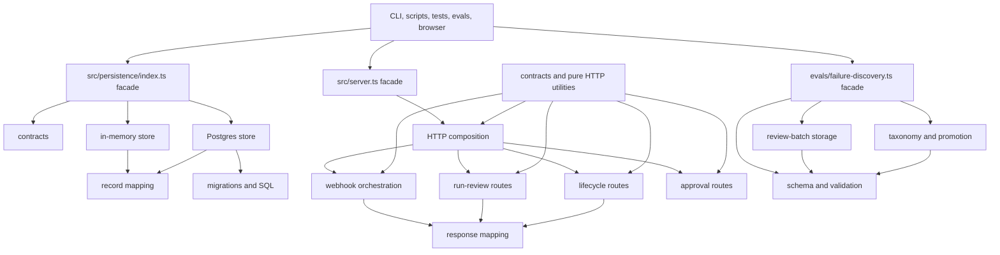
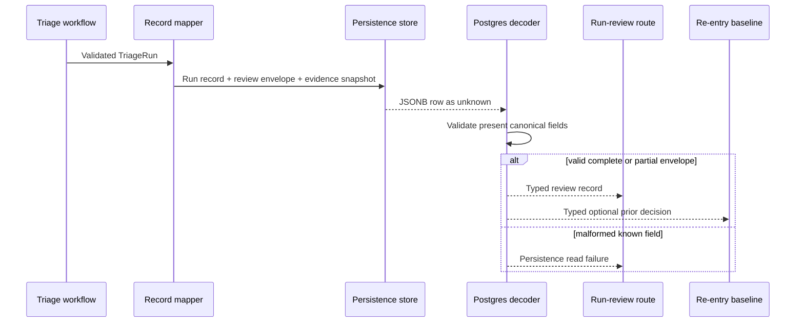
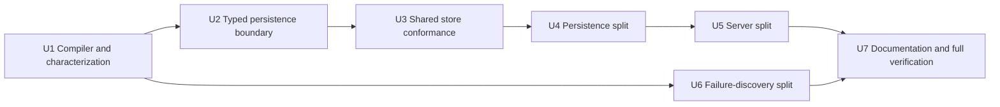

# Incident Triage Core Module Simplification - Plan

## Goal Capsule

- **Objective:** Engineers can change incident persistence, HTTP orchestration, and failure review without re-reading several thousand-line modules or risking silent divergence between execution paths.
- **Means:** Establish typed boundaries and shared behavioral contracts, then split the three oversized modules behind their current public import paths (KTD1-KTD7).
- **Authority:** Product Contract requirements and repository hard constraints govern behavior; Key Technical Decisions govern module ownership; Implementation Units govern sequencing.
- **Execution profile:** Deep, behavior-preserving refactor across persistence, server routing, eval tooling, tests, and source-map documentation.
- **Stop conditions:** Stop and reassess if implementation requires a database migration, endpoint or response-shape change, authorization change, new framework, or weakened deterministic safety check.
- **Completion owner:** `ce-work` or an engineer implements and verifies the units; commit, push, and merge remain separate shipping actions.

---

## Product Contract

### Summary

Apply all seven simplification findings while preserving every existing operator, automation, persistence, and safety contract.
The result keeps current imports and observable behavior but gives persistence, HTTP handling, and failure discovery clear ownership boundaries.

### Problem Frame

The project has accumulated production-shaped behavior in three large files: `src/persistence/index.ts`, `src/server.ts`, and `evals/failure-discovery.ts`.
Their current behavior is well tested, but unrelated responsibilities share files and persistence data is partially reinterpreted after it crosses the database boundary.
This raises the cost of reviewing changes and makes it easier for in-memory, Postgres, direct-run, persisted-review, and failure-promotion paths to drift.

### Key Decisions

- **Apply the complete simplification audit.** (session-settled: user-directed — chosen over applying only findings 1-3 or another subset: the user confirmed that all seven findings should be planned together.) Governs R1-R9.

### Requirements

**Behavior and compatibility**

- R1. Preserve current CLI, HTTP, browser, eval, recorded-observability, persistence, and failure-review behavior, including public import paths and response contracts.
- R2. Preserve deterministic ownership of validation, authorization, replay protection, lifecycle transitions, mitigation policy, approval gates, non-execution guarantees, and human-controlled failure promotion.
- R3. Existing pre-refactor behavior that is outside the audit scope must remain characterized rather than silently changed, including baseline selection, duplicate-key payload handling, verification/recovery atomicity, local approval authorization, and cross-process pre-triage concurrency.

**Type and persistence boundaries**

- R4. Remove the unused recorded-triage timestamp helper and make unused locals and parameters TypeScript errors across source, scripts, tests, evals, and Playwright configuration.
- R5. Represent `TriageRunReviewEnvelope` with canonical domain types and decode Postgres JSONB once at row mapping; omitted known fields and unknown additive keys remain compatible, while malformed present fields fail the read.
- R6. Require `listTriageRuns`, `getTriageRunReview`, and `releaseReplayKey` on every `TriageRunPersistenceStore`; keep Postgres-only lifecycle hooks such as `migrate` and `close` optional.

**Module ownership and proof**

- R7. Split persistence, server, and failure-discovery responsibilities into focused modules while retaining `src/persistence/index.ts`, `src/server.ts`, and `evals/failure-discovery.ts` as explicit compatibility facades.
- R8. Run one observable persistence conformance suite against the in-memory and Postgres implementations without making Postgres a dependency of the default test suite.
- R9. Update current source maps in `README.md` and `AGENTS.md` so contributors can find the new ownership boundaries.

### Acceptance Examples

- AE1. **Recoverable run remains readable.** Given a persisted run with investigation and invalid validation details but no decision, safety result, or mitigation result, when Postgres maps the row, then the partial envelope is accepted and the review API preserves the recoverable outcome. Covers R1, R5.
- AE2. **Malformed trusted-looking data fails closed.** Given a persisted envelope with a malformed known field or an executable artifact marked `executed: true`, when any row-reading path decodes it, then the row read fails and the existing server error boundary returns its generic internal error contract. Covers R2, R5.
- AE3. **Absent store behavior is unchanged.** Given a runtime with no run store, when an operator requests the run list, run review, or lifecycle data, then the current route-specific unavailable response remains unchanged even though a present store has a complete operational contract. Covers R1, R6.
- AE4. **Both stores satisfy one contract.** Given equivalent unique fixtures and deterministic clocks, when the shared conformance suite runs against each store, then both implementations return the same externally visible ordering, idempotency, lifecycle, recovery, candidate, replay, and cleanup behavior. Covers R6, R8.
- AE5. **Webhook security order survives extraction.** Given signed, invalid, duplicate, successful, and failing Grafana requests, when the extracted server handles them, then raw-body authentication, JSON parsing, replay claims, release behavior, and status payloads occur in the current order. Covers R1-R3, R7.
- AE6. **Failure promotion remains human-controlled.** Given imported runtime outcome candidates, when failure-discovery code is split, then batch review, first-failure validation, allowlisting, credential rejection, two-source activation, immutable revisions, and explicit CLI promotion remain required. Covers R2, R7.

### Success Criteria

- All existing imports compile through the three compatibility facades.
- Default tests remain Docker-free and Postgres-free.
- Postgres-backed conformance and malformed-envelope coverage pass when a test database is supplied.
- Direct run output and persisted review output retain equivalent decision, evidence, provenance, safety, mitigation, lineage, and lifecycle meaning.
- No new runtime dependency, database migration, endpoint, response field, or authorization rule is introduced.

### Scope Boundaries

**Included**

- The seven audit findings, compatibility facades, typed envelope decoding, semantic parity characterization, shared persistence conformance, source-map documentation, and verification of established execution paths.

**Deferred to Follow-Up Work**

- Any non-obvious ordering constraint or backend mismatch discovered during implementation may be captured later as a durable solution learning after the refactor is verified.

**Outside this plan**

- Filtering recoverable runs out of incident baselines.
- Detecting payload mismatches behind duplicate idempotency keys.
- Making verification and follow-up recovery reservation one transaction.
- Redesigning local approval API authorization.
- Adding distributed pre-triage locking, a routing framework, a persistence framework, or a new validation library.

### Sources

- `CONCEPTS.md` defines the current Incident Triage Domain vocabulary.
- `AGENTS.md` defines the safety, testing, persistence, and operator-mode constraints this refactor must preserve.
- `src/persistence/index.ts`, `src/server.ts`, and `evals/failure-discovery.ts` contain the responsibilities being separated.
- `tests/persistence.test.ts`, `tests/postgres-persistence.test.ts`, `tests/server.test.ts`, and `tests/failure-discovery.test.ts` establish current observable contracts.
- `docs/solutions/architecture-patterns/bounded-llm-incident-triage-workflow.md` requires deterministic application ownership and one execution path through validation and safety controls.

---

## Planning Contract

### Key Technical Decisions

- KTD1. **Keep stable compatibility facades as terminal dependencies.** The existing persistence, server, and failure-discovery entry files will use explicit named re-exports so callers do not migrate and internal helpers do not become public accidentally. Internal modules import leaf contracts directly and never import a facade. Implements R1, R7.
- KTD2. **Decode persisted envelopes at the Postgres trust boundary.** Postgres row types treat `review_envelope` as `unknown`; one Postgres-only decoder validates every present known field into canonical domain types, treats database or JSON null as absent, accepts omitted fields and an empty object, drops unknown keys, and applies no new cross-field product rules. Summary queries do not select or decode envelopes they do not expose. A malformed row aborts detail, baseline, and conflict reads rather than falling back to raw JSON, an older baseline, or inferred action. Implements R2, R5.
- KTD3. **Require operational store capabilities only.** The three methods implemented by both stores become required, while `migrate` and `close` remain optional backend lifecycle hooks rather than artificial in-memory no-ops. Implements R6.
- KTD4. **Use observable behavior as the shared store contract.** A factory-driven conformance suite proves public behavior for both backends, including current first-write-wins behavior when one idempotency key is reused with different content. Postgres transactions, locks, migrations, and malformed-row handling remain backend-specific tests. Implements R8.
- KTD5. **Keep one ordered HTTP composition layer.** Route handlers move into focused modules. The composition module retains route precedence and top-level error mapping, while `src/server/webhook.ts` retains raw-body limits, HMAC and freshness checks, JSON parsing, replay claim and release, and triage orchestration so direct and network use share one security sequence. Replay identity continues to use canonicalized signature, timestamp, sender, and body digest; success retains the claim until expiry, while handled failures attempt release without allowing release failure to replace the original outcome. Implements R1-R3, R7.
- KTD6. **Separate failure-review policy from storage mechanics and runtime authority.** Shared schemas and validation sit below review-batch I/O and taxonomy promotion. Runtime, server, workflow, eval-runner, and batch modules cannot invoke taxonomy mutation; only explicit failure-review CLI orchestration and tests may call promotion, revision, or retirement. Implements R2, R7.
- KTD7. **Characterize before moving ownership.** Compiler checks, response parity assertions, envelope decoder tests, and persistence conformance land before or alongside physical extraction so each move is evaluated against existing outcomes. Implements R1-R8.
- KTD8. **Enforce inward-only module dependencies.** Leaf contracts and pure utilities may be imported by stores and handlers. Server handlers feed `src/server/composition.ts`, and each compatibility facade may directly named-re-export existing public symbols from its owning modules. Internal modules must not import a compatibility facade or sibling route module. Implements R7.
- KTD9. **Keep response mapping pure.** Run-review orchestration resolves approval and lifecycle data plus derived states before calling mappers; response mappers cannot import stores, runtime configuration, authorization helpers, or route handlers. Implements R1, R2, R7.

### Side-Effect Ownership

| Side effect | Authorized owner | Read-only consumers |
| --- | --- | --- |
| Approval decision | Existing local approval handler or explicit operator CLI under the current local/demo authority model | Workflow, webhook, persisted review, browser reads, evals |
| Lifecycle verification, recovery, reset, and feedback | Existing lifecycle handlers after write authorization and idempotency validation | Run review, browser reads, recorded and eval paths |
| Failure taxonomy promotion, revision, and retirement | Explicit failure-review CLI orchestration and tests | Runtime candidates, review batches, server, workflow, eval runners |
| Postgres run and lifecycle mutation | Postgres store methods within their current transaction and lock boundaries | Response mapping and review projection |

These are trusted human-intent channels under the current project model, not proof of individual human identity. Stronger identity enforcement remains outside R1-R9.
Approval staging and read projection remain separate from the human decision command; webhook orchestration cannot import that command. Production `src/**` code cannot import failure-taxonomy mutation, and runtime candidate import cannot call promotion.

### Route Policy Ownership

| Route group | Composition responsibility | Handler responsibility |
| --- | --- | --- |
| Health and HTML consoles | Exact precedence and final 404 ordering | Response content only |
| Approval surfaces | Apply read-only suppression before dispatch | Preserve current method and local-mode decision behavior |
| Run review and candidates | Dispatch after approval and demo routes | Read authorization, store availability, and current error payloads |
| Lifecycle mutations | Dispatch by exact incident route | Method check, write authorization, idempotency key, body parsing, ownership validation, then persistence |
| Grafana webhook | Dispatch last before final 404; own top-level error mapping | Raw-body limit, HMAC/freshness, JSON parse, replay claim/release, then triage orchestration |
| Shared predicates | No route imports | Live in leaf HTTP/auth utilities that import neither handlers nor composition |

### High-Level Technical Design

#### Module ownership



#### Persisted review data flow



### Output Structure

```text
src/
  persistence/
    contracts.ts
    record-mapping.ts
    postgres-row-mapping.ts
    in-memory.ts
    postgres.ts
    index.ts
  server/
    contracts.ts
    http.ts
    webhook.ts
    approval.ts
    run-review.ts
    lifecycle.ts
    response-mapping.ts
    composition.ts
  server.ts
evals/
  failure-discovery/
    schema.ts
    artifact-io.ts
    review-batch.ts
    taxonomy-promotion.ts
  failure-discovery.ts
tests/
  architecture.test.ts
  support/
    persistence-conformance.ts
scripts/
  check-retained-envelopes.ts
```

The exact internal helper placement may adjust during implementation, but dependency direction and the three public facade paths are fixed.

### Cross-Surface Parity Contract

| Semantic field | CLI / direct run | Webhook / eval | Persisted review API | Browser | Mutation authority |
| --- | --- | --- | --- | --- | --- |
| Decision, validation, recoverability | Required where produced | Required where produced | Required where retained | Display only | None |
| Evidence IDs, missing context, provenance | Required | Required | Required | Display only | None |
| Safety, approval posture, mitigation state, `executed` flags | Required | Required | Required | Display only | None |
| Gate lineage and lifecycle | Surface-specific where available | Required for re-entry/lifecycle paths | Required | Display only | Existing lifecycle write channel only |
| Approval and taxonomy actions | Not granted by model output | Not granted | Not granted | Existing authorized controls only | Trusted human-intent channels in Side-Effect Ownership |

Parity is semantic rather than byte-for-byte because each surface intentionally uses a different outer envelope.

### Sequencing



### System-Wide Impact

- **Operators:** API status codes, payload shapes, review UI data, authorization, and simulation boundaries remain unchanged.
- **Automation and agents:** CLI, webhook, eval, recorded-input, and persisted-review surfaces continue to expose the same bounded decision and evidence semantics.
- **Authority:** Stored artifacts and model output remain evidence or proposals; they never confer approval, lifecycle-write, or taxonomy-mutation authority.
- **Developers:** Smaller ownership modules and stricter TypeScript checks reduce the context needed for future changes; compatibility facades prevent caller churn.
- **Operations:** Postgres migrations and stored shapes remain unchanged; deployment artifacts continue copying persistence SQL to the existing build location. Stricter decoding can expose an incompatible retained envelope as a failed read, so retained data must pass a read-only compatibility check before deployment.

### Risks and Mitigations

| Risk | Consequence | Mitigation |
| --- | --- | --- |
| Envelope validation rejects legitimate historical partial rows | Review, baseline, or conflict reads fail after deployment; summary lists remain readable because they do not select the envelope | Accept null, omitted fields, and empty envelopes; ignore unknown keys; cover every historical writer shape; require the read-only retained-row compatibility command before deployment |
| Extraction changes transaction or advisory-lock scope | Duplicate or partial lifecycle records become possible | Keep transaction helpers on `PoolClient`, preserve lock keys and SQL, and retain backend-specific rollback/concurrency tests |
| Extracted routes change precedence or security order | A route bypasses auth, read-only suppression, or replay handling | Keep one ordered composition module and preserve real-HTTP route tests |
| New modules form cycles | Ownership becomes less clear than before | Put shared contracts and pure validation below implementations; keep facades export-only |
| Shared Postgres tests collide with durable uniqueness constraints | Reruns fail for fixture reasons | Generate unique IDs and source keys, use deterministic clocks, run Postgres cases sequentially, and close backend resources |
| Default verification starts requiring infrastructure | Local and CI feedback becomes slower or unavailable | Keep the Postgres conformance invocation behind the existing database environment guard |

---

## Implementation Units

### U1. Establish compiler guardrails and behavior characterization

- **Goal:** Remove confirmed dead code and make the compiler plus focused characterization tests detect behavior drift before modules move.
- **Requirements:** R1-R4, R7.
- **Dependencies:** None.
- **Files:** `tsconfig.json`, `scripts/run-recorded-triage.ts`, `tests/architecture.test.ts`, `tests/server.test.ts`, `tests/persistence.test.ts`.
- **Approach:** Enable `noUnusedLocals` and `noUnusedParameters` in the root compiler configuration and delete only the unused script helper. Add focused characterization where current tests do not already pin absent-store errors, direct-versus-persisted semantic parity, recoverable baseline behavior, and public facade exports.
- **Execution note:** Establish the characterization assertions before extracting modules; avoid tests that pin source-file locations except where migration asset ownership is the behavior under test.
- **Patterns to follow:** Root TypeScript configuration, outcome-oriented assertions in `tests/server.test.ts`, and shared outcome helpers in `tests/support/outcomes.ts`.
- **Test scenarios:**
  1. A runtime without a run store keeps the current run-list, run-review, and lifecycle unavailable responses.
  2. Completed and recoverable fixtures produce one normalized semantic projection across CLI, direct run mapping, webhook/eval output, recorded-input output, persisted review, and applicable browser rendering.
  3. Non-material and lifecycle-bearing fixtures preserve lineage, lifecycle, approval visibility, and the intentional absence of safety, mitigation, approval, or execution artifacts when those stages did not run.
  4. A recoverable invalid-decision run remains a valid baseline candidate under current retention rules.
  5. A compile-time consumer imports every currently public value and type from all three facades, while runtime smoke assertions confirm public class and function identity and exclude internal helpers.
  6. An architecture assertion rejects internal imports of compatibility facades, sibling route modules, approval mutation from non-approval modules, and taxonomy mutation from runtime modules.
- **Verification:** The root typecheck passes with unused checks active, and focused characterization tests pass without changing existing outcomes.

### U2. Define the typed persisted-review boundary

- **Goal:** Replace loose envelope values with canonical domain types and fail closed when Postgres returns malformed known fields.
- **Requirements:** R1, R2, R5, R6; covers AE1-AE3.
- **Dependencies:** U1.
- **Files:** `package.json`, `src/persistence/contracts.ts`, `src/persistence/record-mapping.ts`, `src/persistence/postgres-row-mapping.ts`, `src/persistence/index.ts`, `src/server.ts`, `scripts/check-retained-envelopes.ts`, `scripts/run-recorded-triage.ts`, `tests/persistence.test.ts`, `tests/postgres-persistence.test.ts`, `tests/server.test.ts`.
- **Approach:**
  1. Define the envelope from existing investigation, validation-summary, explanation, decision, safety, mitigation-control, and provenance types.
  2. Treat the Postgres row field as untrusted and decode it in the row mapper according to KTD2.
  3. Make the three operational store methods required and remove method-level optional branches while preserving runtime-level missing-store behavior.
  4. Simplify review mapping and prior-decision recovery to consume typed values instead of generic object traversal or double casts.
  5. Add `npm run triage:audit-retained-envelopes -- --json`, backed by a dedicated script that keyset-scans every non-null retained envelope through the shared Postgres decoder inside an explicit read-only transaction. The supplied `DATABASE_URL` must use a least-privilege read-only role; the script must not instantiate store lifecycle hooks, run migrations, perform cleanup, or emit connection strings or envelope contents. Output is limited to aggregate counts and opaque run IDs, errors are sanitized, and any incompatible row exits nonzero.
- **Patterns to follow:** Type-only imports required by `verbatimModuleSyntax`, existing bounded validators in `src/llm.ts`, and row-to-domain mapping in persistence.
- **Test scenarios:**
  1. A complete valid envelope round-trips with every canonical field intact.
  2. A recoverable partial envelope and an empty envelope remain readable.
  3. Database null, JSON null, an empty object, and unknown top-level keys remain compatible without changing canonical output.
  4. A malformed present field, invalid taxonomy literal, or `executed: true` executable artifact fails the Postgres row read.
  5. Review lookup, baseline lookup, and gated-conflict lookup use the same decoder, while run-list summary queries do not select or decode the envelope.
  6. A present store is called directly for list, review, and replay release; an absent store retains existing route errors.
  7. A malformed newest baseline, detail record, or gated-conflict row fails the consuming operation without trying an older baseline, skipping the row, or exposing persisted content; `listTriageRuns` remains readable because its summary query does not select `review_envelope`.
  8. The retained-envelope audit command scans all non-null envelopes with a read-only database role and transaction, reports no persisted payload content, exits zero for compatible rows, and exits nonzero with sanitized diagnostics for incompatible rows.
- **Verification:** No `unknown` envelope traversal or unsafe decision cast remains outside the Postgres decoder, complete and partial review paths preserve their current output, and the retained-envelope audit command is executable without mutation authority.

### U3. Create the shared persistence conformance suite

- **Goal:** Make one behavioral contract detect drift between the in-memory and Postgres stores.
- **Requirements:** R1-R3, R6, R8; covers AE4.
- **Dependencies:** U2.
- **Files:** `tests/support/persistence-conformance.ts`, `tests/persistence.test.ts`, `tests/postgres-persistence.test.ts`.
- **Approach:** Register the same observable cases against a store factory and teardown harness. Invoke the in-memory harness in the default suite and the Postgres harness only under the existing database environment guard. Keep migration, transaction rollback, locking, malformed-row, and implementation-internal tests outside the shared contract per KTD4.
- **Execution note:** Use unique incident IDs, run IDs, digests, event keys, and candidate IDs for every case; keep Postgres cases sequential and deterministic.
- **Patterns to follow:** Existing environment-gated Postgres test setup and realistic run builders in persistence tests.
- **Test scenarios:**
  1. Completed and recoverable runs retain separate review envelopes and evidence snapshots.
  2. Run listing applies newest-first ordering and bounded limits.
  3. Baseline lookup requires unexpired run and snapshot records.
  4. Gate decisions are baseline-scoped and idempotent, with correct child lineage and duplicate suppression.
  5. Verification writes are idempotent and unresolved outcomes create exactly one review candidate.
  6. Recovery budgets remain isolated by failure class, exhaust at three attempts, and reset into a new audited generation.
  7. Outcome candidates support filtering, idempotent creation, and import transitions.
  8. Replay keys reject duplicates, release explicitly, and become claimable after release or expiry.
  9. Retention cleanup removes expired public records and reports accurate category counts.
  10. Reusing verification, recovery, evidence-gate, or candidate idempotency keys with different content returns the first result and creates no second event, budget mutation, candidate, or lineage edge.
  11. Baseline reads enforce run-plus-snapshot expiry, while list, review, lifecycle, candidate, and parent-retention visibility remains presence-based until cleanup.
- **Verification:** The same contract cases pass for in-memory storage by default and for Postgres when a test database is available, without replacing backend-specific coverage.

### U4. Split persistence by ownership

- **Goal:** Turn `src/persistence/index.ts` into a small facade over contracts, mapping, in-memory, and Postgres modules.
- **Requirements:** R1-R3, R5-R8.
- **Dependencies:** U3.
- **Files:** `src/persistence/contracts.ts`, `src/persistence/record-mapping.ts`, `src/persistence/postgres-row-mapping.ts`, `src/persistence/in-memory.ts`, `src/persistence/postgres.ts`, `src/persistence/index.ts`, `src/outcome-promotion.ts`, `tests/persistence.test.ts`, `tests/postgres-persistence.test.ts`.
- **Approach:** Move public records and interfaces into contracts, backend-neutral IDs and builders into record mapping, Postgres row types and decoding into Postgres-only row mapping, map-backed behavior into in-memory, and pool/SQL/transactions/migrations into Postgres. Extract leaf modules first, redirect internal consumers such as `src/outcome-promotion.ts` to leaf contracts, and convert the facade last per KTD8. Keep migration lookup in `src/persistence/` so source and built asset locations do not change. Re-export only the existing public surface, including `buildReplayKey`.
- **Patterns to follow:** Current transaction-scoped `PoolClient` helpers, advisory locks, migration ledger, explicit error propagation, and persistence naming.
- **Test scenarios:**
  1. Existing imports from `src/persistence` compile without caller changes.
  2. Source and built migration lookup resolve the current migration directory.
  3. Migration ownership, checksums, and advisory locking retain existing behavior.
  4. Gated writes, verification-plus-candidate writes, and recovery/exhaustion writes roll back as one Postgres transaction on failure.
  5. Concurrent class-specific recovery writes retain the current lock and budget behavior.
  6. The shared conformance suite continues passing after physical extraction.
  7. Migration-ledger plus migration, run plus snapshot, gate plus child plus snapshot, verification plus unresolved candidate, recovery attempt plus budget plus exhaustion event plus candidate, reset plus budget, and retention deletions each retain their current one-client rollback boundary.
  8. Startup cleanup, periodic cleanup warnings, shutdown cancellation, and transactional deletion order remain unchanged.
- **Verification:** The facade contains exports rather than implementation, in-memory code has no runtime dependency on `pg`, SQL and lock boundaries remain unchanged, and persistence tests pass on applicable backends.

### U5. Split HTTP composition, routes, and response mapping

- **Goal:** Separate server responsibilities while preserving one authoritative route and security sequence.
- **Requirements:** R1-R3, R5-R7; covers AE3, AE5.
- **Dependencies:** U4.
- **Files:** `src/loki.ts`, `src/recorded-observability.ts`, `src/server/contracts.ts`, `src/server/http.ts`, `src/server/webhook.ts`, `src/server/approval.ts`, `src/server/run-review.ts`, `src/server/lifecycle.ts`, `src/server/response-mapping.ts`, `src/server/composition.ts`, `src/server.ts`, `tests/server.test.ts`, `tests/webhook-outcomes.test.ts`, `tests/observability-integration.test.ts`, `tests/e2e/run-review-approval.pw.ts`.
- **Approach:** Move `LokiClientLike` to the Loki boundary so recorded observability does not import the server facade. Extract leaf contracts and HTTP predicates, pure serializers, approval query/command ownership, route handlers, composition, then the facade. Run-review orchestration resolves approval and lifecycle reads before mapping per KTD9. Keep direct `handleGrafanaWebhook` use independent of the network server.
- **Patterns to follow:** Existing Node HTTP primitives, current route-owned authorization helpers, `WeakMap` incident coordinator, and real-HTTP server tests.
- **Test scenarios:**
  1. Health, consoles, approval suppression, approval APIs, demo APIs, run-review APIs, lifecycle APIs, candidate APIs, webhook, and final 404 retain their ordering and status payloads.
  2. Oversized bodies stop before authentication; invalid signatures stop before JSON parsing; invalid JSON stops before replay claim.
  3. Successful webhook handling retains the replay claim, while non-2xx and thrown processing release it without replacing the original response.
  4. Read tokens authorize reads but never writes; write tokens and loopback-local fallback retain current behavior.
  5. Read-only mode hides approval routes and emits no approval, dry-run, staged-action, or execution artifacts.
  6. Equivalent evidence remains suppressed, material evidence creates one child lineage, and same-incident in-process serialization remains intact.
  7. Browser review and approval workflows render the same operator-visible states after extraction.
  8. Concurrent claims allow one Postgres winner; exact-expiry reuse, signature-case normalization, release failure, and process-loss TTL behavior remain unchanged.
  9. A malformed baseline releases any claimed replay key and creates no child run, snapshot, lifecycle event, candidate, approval record, or promotion artifact.
  10. Approval and lifecycle read failures preserve current propagation and the derived `awaiting_verification` projection.
- **Verification:** The public `src/server.ts` surface remains unchanged, server and browser tests pass, and direct plus persisted response paths preserve semantic parity without sharing an outer DTO.

### U6. Split failure-discovery schemas, batch storage, and promotion policy

- **Goal:** Separate failure-review concerns without weakening human review, redaction, or immutable taxonomy history.
- **Requirements:** R1-R3, R7; covers AE6.
- **Dependencies:** U1.
- **Files:** `evals/failure-discovery/schema.ts`, `evals/failure-discovery/artifact-io.ts`, `evals/failure-discovery/review-batch.ts`, `evals/failure-discovery/taxonomy-promotion.ts`, `evals/failure-discovery.ts`, `scripts/failure-review.ts`, `tests/failure-discovery.test.ts`.
- **Approach:** Keep schema records, parsers, canonicalization, and pure validation in `schema.ts`; put path handling and atomic filesystem reads/writes in `artifact-io.ts`. Review-batch and taxonomy-promotion may import both leaf modules but never each other. Enforce KTD6 and KTD8 through the architecture assertion introduced in U1.
- **Patterns to follow:** Existing path-safe IDs, mode-`0600` atomic replacement, first-upstream-failure validation, two-source activation, immutable promoted cases, and append-only taxonomy revisions.
- **Test scenarios:**
  1. Batch creation, annotation, completion, loading, validation, and summary rendering preserve current artifact shapes.
  2. Path traversal and unsupported schema versions remain rejected with field-specific diagnostics.
  3. Candidate snapshots remain reduced, canonical, immutable, and free of credential-bearing keys.
  4. Named modes still require two distinct reviewed sources; revisions and retirement preserve historical versions.
  5. Importing runtime outcome candidates never activates or changes taxonomy or executable regressions.
  6. Existing imports from `evals/failure-discovery.ts` compile unchanged for the CLI, catalog, regressions, and tests.
  7. Candidate import, batch completion, persisted review, and eval execution create no approval decision, taxonomy revision, retirement, or promoted regression.
  8. Promotion validates all inputs before mutation; failure after case-file creation retains the current observable partial-state behavior and requires explicit operator remediation rather than silently claiming atomicity.
- **Verification:** The facade is export-only, module dependencies are acyclic, the CLI remains the explicit promotion entry point, and deterministic failure-discovery tests pass.

### U7. Refresh documentation and verify every established surface

- **Goal:** Make the new ownership map discoverable and prove the complete refactor across default, browser, eval, recorded, build, and optional Postgres paths.
- **Requirements:** R1-R3, R7-R9.
- **Dependencies:** U5, U6.
- **Files:** `README.md`, `AGENTS.md`.
- **Approach:** Update only current source-map descriptions and contributor guidance affected by the new module layout. Run the repository verification matrix and record any unavailable Postgres environment as an outstanding verification condition rather than treating it as a pass.
- **Test expectation:** No new test cases are required solely for documentation; this unit executes the plan-wide verification contract.
- **Verification:** Documentation points to the facade and internal ownership modules accurately, all applicable quality gates pass, and no abandoned extraction helpers or experimental modules remain.

---

## Verification Contract

| Gate | Command | Required outcome |
| --- | --- | --- |
| Type safety and unused checks | `npm run typecheck` | All source, scripts, tests, evals, and Playwright config compile with no unused declarations |
| Deterministic default behavior | `npm test` | All default tests pass without Docker, Postgres, Grafana, Loki, or provider credentials |
| Postgres parity and trust boundary | `npm run test:postgres` | Shared conformance, malformed-envelope, migration, transaction, and lock tests pass when a test database URL is available |
| Retained-envelope compatibility | `DATABASE_URL=<read-only-role-url> npm run triage:audit-retained-envelopes -- --json` | Every retained non-null envelope is checked in an explicit read-only transaction; output contains only aggregate counts and opaque run IDs; incompatible rows stop deployment and require separate remediation |
| Browser-visible operator behavior | `npm run test:e2e` | Run review, approval, lifecycle, error, loading, and narrow-viewport workflows pass |
| Read-only production-shaped path | `npm run triage:read-only-canary -- --json` | Signed ingestion, replay protection, persistence, lifecycle, review, and disabled approval behavior remain intact |
| Eval contracts | `npm run evals` | Deterministic schema, grounding, provenance, mitigation, safety, and readability gates pass |
| Build and assets | `npm run build` | TypeScript output and persistence migration assets build at their current paths |
| Diff hygiene | `git diff --check` | No whitespace errors or accidental generated artifacts are present |

The Postgres gate is conditionally required when its environment is available. If it cannot run, implementation is not fully verified for backend-specific integration behavior and the handoff must say so explicitly.
Because this refactor changes no schema or stored data, rollback is application-only; it must not rewrite retained envelopes.

---

## Definition of Done

- U1 is complete when the unused helper is gone, root unused checks are active, and characterization coverage protects current boundary behavior.
- U2 is complete when all persisted envelope consumers receive canonical typed data from one Postgres decoder and malformed known fields fail closed.
- U3 is complete when one conformance contract runs against in-memory storage by default and Postgres under its existing opt-in guard.
- U4 is complete when persistence responsibilities live in focused modules, facade imports remain stable, and transaction, lock, and migration behavior is unchanged.
- U5 is complete when server responsibilities live in focused modules, route/security ordering is unchanged, and HTTP plus browser contracts pass.
- U6 is complete when failure-discovery ownership is acyclic and human promotion, redaction, atomic writes, and taxonomy history remain intact.
- U7 is complete when current documentation describes the new source map and every applicable verification gate passes.
- The final diff contains no new framework, dependency, migration, endpoint, response contract, authorization behavior, or product capability.
- Experimental branches, duplicate helpers, temporary adapters, and abandoned extraction code are removed before completion.
